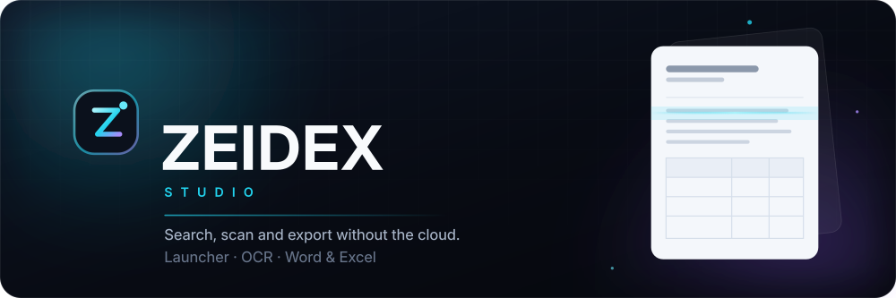
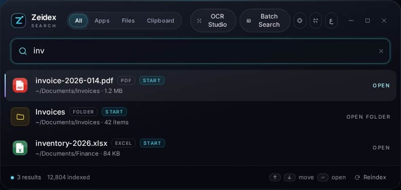
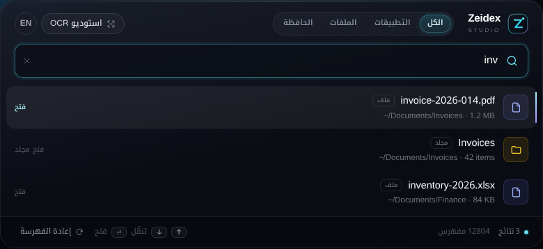
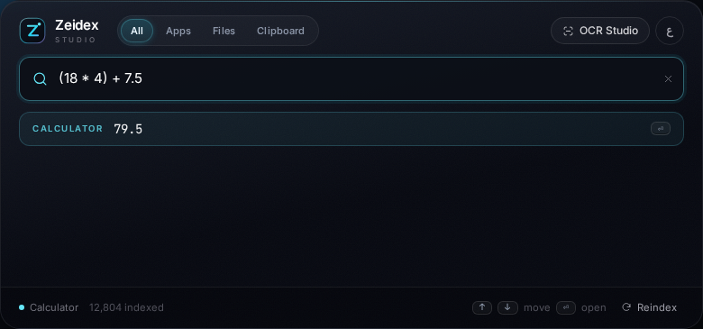
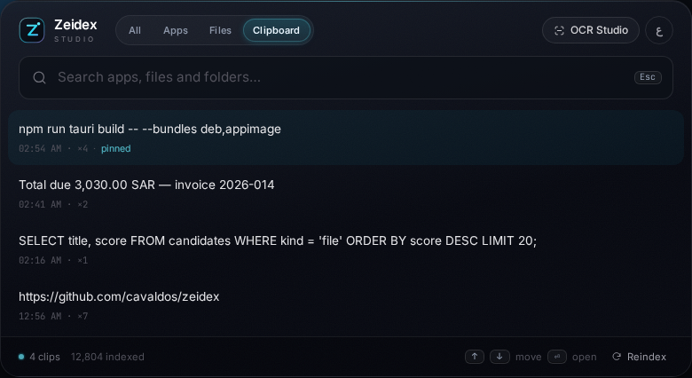
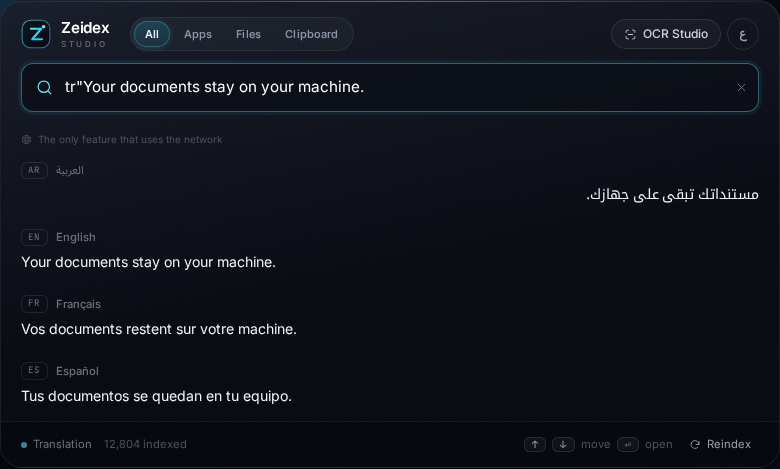
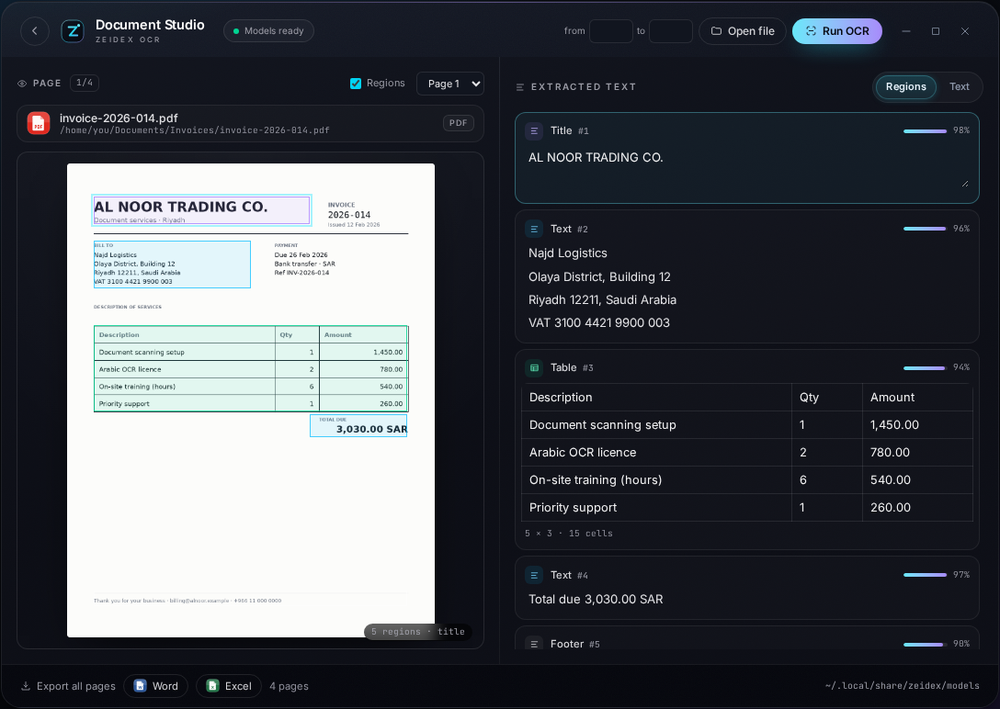
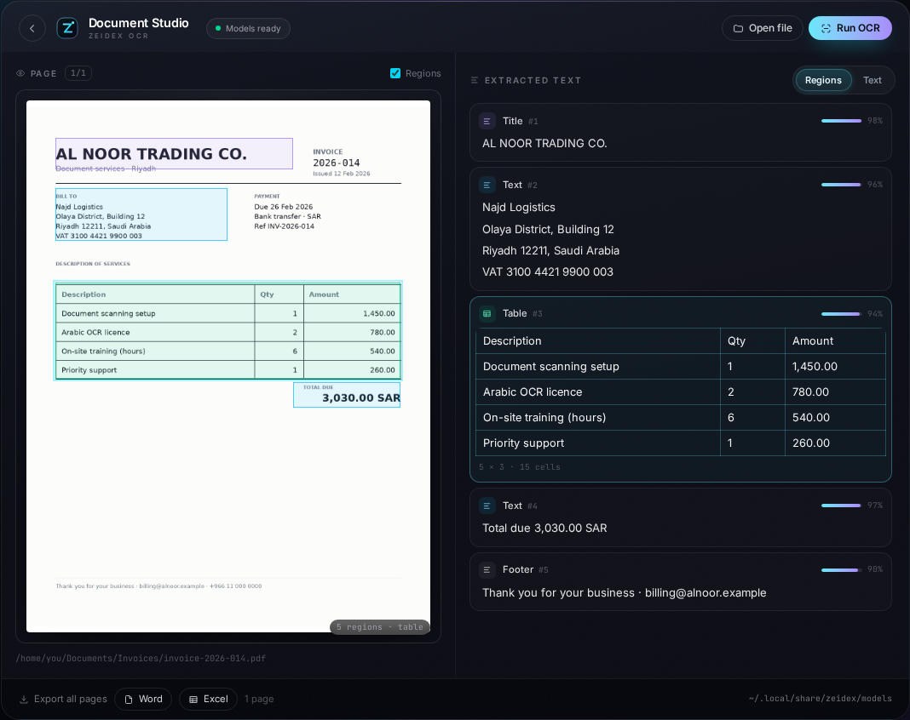
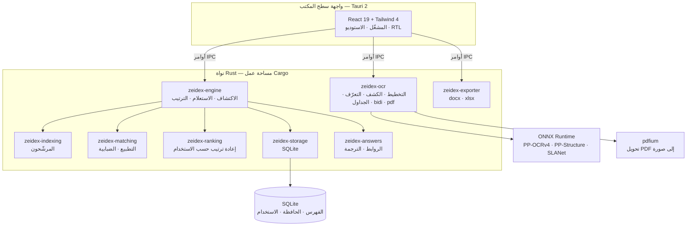
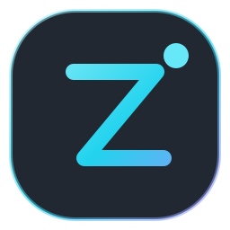

<p align="center">
  <picture>
    <source srcset="assets/brand/zeidex-hero-static.png" media="(prefers-reduced-motion: reduce)" />
    <source srcset="assets/brand/zeidex-hero-animated.gif" type="image/gif" />
    
  </picture>
</p>

<h1 align="center">Zeidex Studio</h1>

<p align="center">
  <strong>ابحث عن أي شيء، شغّل أي تطبيق، وحوّل الورق إلى مستندات قابلة للتحرير — دون أن يغادر جهازك.</strong>
</p>

<p align="center">
  <a href="README.md">English</a> · <b>العربية</b>
</p>

<p align="center">
  <a href="LICENSE"></a>
  
  
  
  
  
</p>

<p align="center">
  <a href="https://github.com/zeiad6/zeidex/releases/latest"><b>نزّل أحدث إصدار</b></a><br>
  <sub>Windows — <code>.msi</code> / <code>.exe</code> · Linux — <code>.deb</code> / <code>.AppImage</code></sub>
</p>

<p align="center">
  <a href="#البدء-السريع">البدء السريع</a> ·
  <a href="https://github.com/zeiad6/zeidex/releases">الإصدارات</a> ·
  <a href="#ما-الذي-يفعله">ما الذي يفعله</a> ·
  <a href="#استوديو-المستندات">استوديو المستندات</a> ·
  <a href="#المعمارية">المعمارية</a> ·
  <a href="#المساهمة">المساهمة</a>
</p>

---

## باختصار

**Zeidex Studio** تطبيق سطح مكتب يجمع شيئين في ملف تنفيذي واحد: مشغّل تطبيقات وملفات، واستوديو مستندات يعمل دون اتصال. اضغط <kbd>Alt</kbd>+<kbd>Space</kbd>، اكتب ثلاثة أحرف، واضغط <kbd>Enter</kbd>: يفتح تطبيق، أو يظهر مجلد، أو تُنسخ نتيجة حسابية إلى الحافظة. وأسقط صورة ممسوحة أو ملف PDF في الاستوديو لتحصل على **ملفات Word وExcel قابلة للتحرير** — مع التنسيق والجداول والخلايا المدمجة والنص العربي من اليمين إلى اليسار.

لا شيء يُرفع إلى الإنترنت. لا حساب، ولا مزامنة، ولا تتبّع، ولا أي اتصال شبكي في مسار الفهرسة أو التعرّف الضوئي على الحروف (OCR). الميزة الوحيدة التي تتصل بالشبكة هي الترجمة، لأنها بطبيعتها تحتاج ذلك.

<table>
  <tr>
    <td width="50%" valign="top">
      <h3>كل شيء محلي</h3>
      <p>البحث يعمل على فهرس SQLite لتطبيقاتك وملفاتك ومجلداتك. والتعرّف الضوئي يعمل على ONNX Runtime بنماذج تُحمَّل من القرص. افصل كابل الشبكة وسيظل التطبيق يعمل.</p>
    </td>
    <td width="50%" valign="top">
      <h3>تطبيق أصلي، لا تبويب متصفح</h3>
      <p>واجهة Tauri حول نواة Rust: ملف تنفيذي أصلي واحد بدل حزمة Chromium كاملة، وقوائم وشريط نظام أصليان، واختصار عام يعمل حتى والنافذة مخفية.</p>
    </td>
  </tr>
  <tr>
    <td width="50%" valign="top">
      <h3>العربية مواطن أول</h3>
      <p>تعرّف ضوئي، وإعادة ترتيب BiDi، وتخطيط من اليمين إلى اليسار، وتصدير Word/Excel يحترم الاتجاه. تنقلب الواجهة بنقرة واحدة باستخدام خصائص CSS المنطقية، فلا يختل موضع أي عنصر.</p>
    </td>
    <td width="50%" valign="top">
      <h3>مستندات، لا نصوص مبعثرة</h3>
      <p>عناوين وقوائم وأشكال وجداول بخلايا مدمجة — كلها تُحفظ في <code>.docx</code> يُفتح كجدول حقيقي، و<code>.xlsx</code> بخلايا رقمية ونطاقات مدمجة.</p>
    </td>
  </tr>
</table>

## ما الذي يفعله

### المشغّل

حقل إدخال واحد وأربعة أوضاع. <kbd>Tab</kbd> يبدّل الفلتر، و<kbd>↑</kbd>/<kbd>↓</kbd> للتنقل، و<kbd>Enter</kbd> للتنفيذ، و<kbd>Esc</kbd> لإخفاء النافذة.

<table>
  <tr>
    <td width="50%"></td>
    <td width="50%"></td>
  </tr>
  <tr>
    <td align="center"><sub>بحث ضبابي في التطبيقات والملفات والمجلدات، مرتّب حسب جودة المطابقة <em>و</em> حسب طريقة استخدامك الفعلية.</sub></td>
    <td align="center"><sub>دعم كامل للعربية: التبويبات والنتائج والأعداد والمستندات المصدَّرة.</sub></td>
  </tr>
</table>

| | |
| --- | --- |
| **البحث** | مطابقة ضبابية تتجاهل التشكيل وحالة الأحرف، ومجموعات أسماء بديلة (`alias_code=Visual Studio Code\|Cursor\|Zed`)، وإعادة ترتيب تعتمد على الاستخدام حتى يفوز ما تفتحه كل صباح عند التعادل. يتحدّث الفهرس تلقائياً أثناء تشغيل التطبيق: ما يُنشأ أو يُعاد تسميته أو يُحذف تحت جذر مراقَب يظهر دون الضغط على إعادة الفهرسة. |
| **الآلة الحاسبة** | اكتب التعبير ويُحسب أثناء الكتابة. <kbd>Enter</kbd> ينسخ الرقم الخام القابل لإعادة التحليل — لا الصيغة المنسّقة `1,000,000`. |
| **سجل الحافظة** | كل نص يُنسخ يُحفظ محلياً في SQLite، بلا تكرار، وقابل للبحث والتثبيت، ولا تنتهي صلاحيته إلا إذا طلبت ذلك. |
| **الترجمة** | `tr"` ثم النص، ليترجم إلى العربية والإنجليزية والفرنسية والإسبانية. كل لغة تفشل باستقلال، فلا تعطّل طلباً واحداً محدود المعدل بقية اللوحة. |
| **بحث الويب والروابط** | اكتب رابطاً لفتحه، أو عبارة للبحث عنها في متصفحك الافتراضي. |
| **التفضيلات** | المحرر والطرفية المفضلان يُحدَّدان لكل نظام، فـ«افتح في المحرر» يعني المحرر الصحيح. |

مرجع لوحة المفاتيح:

| المفتاح | الإجراء |
| --- | --- |
| <kbd>Alt</kbd>+<kbd>Space</kbd> | إظهار أو إخفاء المشغّل (عام، يعمل والنافذة مخفية) |
| <kbd>↑</kbd> <kbd>↓</kbd> | نقل التحديد |
| <kbd>Enter</kbd> | تنفيذ النتيجة المحددة، أو نسخ نتيجة الحاسبة |
| <kbd>Esc</kbd> | إخفاء النافذة |
| <kbd>Tab</kbd> | تبديل الكل ← التطبيقات ← الملفات ← الحافظة |

<table>
  <tr>
    <td width="33.3%"></td>
    <td width="33.3%"></td>
    <td width="33.3%"></td>
  </tr>
  <tr>
    <td align="center"><sub>الحاسبة: <kbd>Enter</kbd> ينسخ القيمة الخام.</sub></td>
    <td align="center"><sub>الحافظة: العناصر المثبّتة تنجو من التنظيف الدوري.</sub></td>
    <td align="center"><sub>الترجمة: أربع لغات، كل واحدة تفشل باستقلال.</sub></td>
  </tr>
</table>

### استوديو المستندات

تدخل الصور وملفات PDF، تخرج صفحة منظّمة. كل صندوق قابل للتحرير، وكل جدول جدولٌ حقيقي، والتصدير مستند يمكنك متابعة العمل فيه.

<table>
  <tr>
    <td width="50%"></td>
    <td width="50%"></td>
  </tr>
  <tr>
    <td align="center"><sub>مناطق التخطيط على اليمين، والنص القابل للتحرير على اليسار. انقر صندوقاً لتنتقل إلى محرّره.</sub></td>
    <td align="center"><sub>SLANet يستعيد الشبكة، بما في ذلك امتدادات الصفوف والأعمدة، قبل التصدير.</sub></td>
  </tr>
</table>

خط المعالجة، كله على جهازك:

```text
صورة / صفحة PDF
   │
   ├─▶ التخطيط       PicoDet (PP-StructureV2، خمس فئات)  ──▶ عنوان · نص · قائمة · جدول · شكل
   │
   ├─▶ أسطر النص     DBNet (PP-OCRv4 det)  ──▶ صناديق مُعاد تحجيمها دون قصّ
   │        └─▶ التعرّف  PP-OCRv4 (قاموسا الإنجليزية والعربية)
   │                 └─▶ إعادة ترتيب BiDi للعربية  ──▶ نص بالترتيب المنطقي
   │
   └─▶ الجداول       مفكّك تسلسل SLANet  ──▶ شبكة وامتدادات ونص كل خلية
                              │
                              ▼
                    نموذج صفحة قابل للتحرير
                              │
                   ┌──────────┴──────────┐
                   ▼                     ▼
              .docx (bidi للعربية،    .xlsx (ورقة RTL،
              جداول أصلية،            خلايا رقمية،
              خلايا مدمجة)            نطاقات مدمجة)
```

لماذا تهم هذه التفاصيل:

- **صناديق الكشف تُوسَّع ولا تُقصّ.** قناع الاحتمال في DBNet يغطي الشريط الأوسط من السطر فقط. قصّه كما هو يقطع امتدادات الحروف العربية والتشكيل، لذلك تُوسَّع الصناديق بنسبة `unclip` في PaddleOCR بعد تطبيق معامل التحجيم.
- **الجداول تُفكّك، لا تُخمَّن.** يُخرج SLANet رموزاً بنيوية (`<thead>` و`<tr>` و`<tbody>` و`colspan` و`rowspan`)، ويبني المحرر الشبكة منها، فما تراه هو ما يكتبه المصدّر.
- **العربية تُخزَّن بالترتيب المنطقي.** الواجهة تُشكّلها للعرض، والمصدّرات تكتب الترتيب المنطقي مع ضبط `bidi` على الفقرة والورقة، وهو ما يتوقعه Word وExcel.
- **ملفات PDF تُحوَّل محلياً** باستخدام pdfium — بلا ghostscript وبلا محوّل سحابي.

### البحث الدفعي

المشغّل يجيب عن استعلام واحد. البحث الدفعي يأخذ **قائمة** — عموداً من جدول، أو رسالة، أو قائمة مجلد — ويسأل، اسماً باسم، هل الملف في الفهرس، وما أقرب شيء إليه إن لم يكن. الصق أو استورد `.txt` أو اكتب؛ يفصل المحلّل عند الأسطر الجديدة والجدولة (الفاصلة والمنقوطة حرفان مشروعان في اسم الملف)، ويطوي التكرار بعد التطبيع، ويعرض ما قبله قبل أن يبدأ شيء. منزلق يضبط عتبة المطابقة من 50% إلى 100%، و100% تعني التساوي بعد التطبيع — لا شيء ضبابي يبلغها. تتوسّع النتائج لكل اسم مع إجراءات الملفات والاختيار المتعدد؛ ومرشّح ثانٍ للعرض فقط يضيّق بحسب نوع الملف وأدنى نسبة دون إعادة البحث، وكل صف يُفتح أو يُظهر مجلده أو يُنسخ بمساره أو باسمه أو يُخفى من الجدول. ويكتب **Export Excel** تقريراً من أربع أوراق: ملخصاً بمخطط، وجدول نتائج قابلاً للتصفية، والأسماء المفقودة، وكل مرشح لاسم طابق أكثر من ملف.

### نماذج OCR ومستشار العتاد

تضمّن الحزمة مجموعة OCR صغيرة واحدة؛ وتضيف شاشة **OCR Models** مستويين أكبر وتتيح التبديل بينها. يقرأ المستشار هذا الجهاز — طراز المعالج وأنويته والذاكرة وكرت الرسوميات والمساحة الحرة — ويصنّفه أساسياً أو قياسياً أو متقدماً أو عالي الأداء وفق معايير منشورة، ويوصي بالمستوى المناسب مع السبب والمقايضات. التنزيلات اختيارية وقابلة للاستئناف، تُفحص ببصمة SHA-256 منشورة، وتُجهَّز وتُتحقَّق مرة أخرى ثم تُفعَّل فقط؛ وفشل التنزيل لا يمسّ الحزمة العاملة. يشغّل **Test** و**Compare models** صفحتَي العيّنة المرفقتين عند الطلب ويبلغان عن معدل خطأ الأحرف والزمن، فلا يُدّعى سرعة أو دقة قبل قياسها هنا.

راجع [نماذج OCR والمستشار](assets/docs/ocr-models.md) للمستويات وتخطيط التخزين وجدول النقاط وأوضاع الفشل.

راجع [كيف تعمل المطابقة](assets/docs/batch-search.md) لجدول الدرجات وقواعد الطي العربي والأداء المقيس.

### الخصوصية

| | |
| --- | --- |
| اتصالات الشبكة في البحث والفهرسة والتعرّف الضوئي والتصدير | **لا شيء** |
| اتصالات الشبكة في الترجمة | نقطة نهاية Google `gtx`، فقط عند استخدام `tr"` |
| التتبّع وتقارير الأعطال والتحليلات | **لا شيء** |
| الملفات المقروءة | فقط ما تفهرسه أو تفتحه |
| تنزيل النماذج | مرة واحدة عبر `scripts/fetch_models.sh` مع التحقق من البصمات |

قاعدة البيانات — فهرس البحث وسجل الحافظة وسجل الاستخدام — تعيش في مجلد بيانات نظامك: `~/.local/share/zeidex` على Linux، و`~/Library/Application Support/zeidex` على macOS، و`%APPDATA%\zeidex` على Windows. احذف ذلك المجلد وينسى التطبيق كل شيء. وملف الإعدادات هو `~/.zeidex/config` على كل الأنظمة.

## البدء السريع

### البناء من المصدر

المتطلبات: Rust (مثبّت في `rust-toolchain.toml`)، وNode 20 أو أحدث، و[متطلبات Tauri](https://v2.tauri.app/start/prerequisites/) المعتادة لنظامك.

```bash
git clone https://github.com/zeiad6/zeidex.git
cd zeidex

# 1. نماذج OCR، مرة واحدة (≈ 35 ميغابايت، مع التحقق من البصمات)
make models

# 2. مكتبات التشغيل: ONNX Runtime وpdfium
#    ضع libonnxruntime.{so,dylib,dll} وlibpdfium.{so,dylib,dll}
#    في src-tauri/resources/lib/ ليشملها الحزمة، أو ثبّتهما
#    على مستوى النظام واضبط ORT_DYLIB_PATH / ZEIDEX_PDFIUM_LIBRARY.

# 3. شغّله
make frontend-install
make tauri-dev            # للتطوير
make tauri-build          # حزم الإصدار لنظامك الحالي
```

ينتج `make tauri-build` ملفات `.deb` و`.appimage` على Linux، و`.msi` و`.nsis` على Windows، و`.dmg` على macOS. لا شيء يُرفع تلقائياً: دفع وسم `v*` يشغّل `.github/workflows/release.yml`، الذي يبني على منصّات أصلية ويرفق الحزم بمسودة إصدار. يُبنى MSI على Windows لأن WiX لا يعمل على Linux. سير العمل يضع ONNX Runtime وpdfium داخل الحزمة؛ والبناء المحلي يستخدم ما هو موجود في `src-tauri/resources/lib/` (انظر [البناء والإصدار](assets/docs/build-and-release.md)).

### التحقق من البناء

```bash
make core-test     # مساحة عمل Rust كاملة
make core-fmt      # التنسيق
make core-clippy   # clippy، مع منع unwrap/expect في مسارات الإنتاج
make frontend-build
make ocr-test      # نماذج حقيقية وصفحة حقيقية — يحتاج ORT_DYLIB_PATH
```

## الاستخدام

| ماذا | كيف |
| --- | --- |
| البحث | <kbd>Alt</kbd>+<kbd>Space</kbd>، اكتب، ثم <kbd>Enter</kbd> |
| الحساب | اكتب التعبير؛ يظهر صف النتيجة فوق النتائج |
| الترجمة | `tr"` + النص |
| سجل الحافظة | <kbd>Tab</kbd> حتى فلتر الحافظة |
| بحث الويب | اكتب عبارة واختر نتيجة الويب، أو اكتب رابطاً لفتحه |
| المستندات | **OCR Studio** في الأعلى ← **Open file** ← **Run OCR** |

الإعدادات في `~/.zeidex/config`:

```ini
# الأدوات المفضلة، تستخدمها إجراءات "افتح في…"
editor=nvim
terminal=alacritty

# عامل هذه التطبيقات كتطبيق واحد عند البحث
alias_code=Visual Studio Code|Cursor|Zed
```

## المعمارية



تُبنى مساحة عمل Rust وتُختبر **دون** Tauri أو Node أو webview، ولهذا يمكن اختبار منطق التعرّف الضوئي والتصدير في CI على نظامي تشغيل.

| الحزمة | المسؤولية |
| --- | --- |
| `zeidex-engine` | الاكتشاف وتحليل الاستعلام والبحث وكشف المنصّة |
| `zeidex-indexing` | نوع `Candidate` ونظام معرّفاته |
| `zeidex-matching` | تطبيع الاستعلام والتنقيط الضبابي |
| `zeidex-ranking` | الدرجة الأساسية معدّلة بمطابقة البداية والاستخدام السابق |
| `zeidex-storage` | SQLite: المرشّحون وأحداث الاستخدام والحافظة وسجل الروابط والإعدادات |
| `zeidex-tools` | تحديد المحرر والطرفية المفضلين لكل منصّة |
| `zeidex-answers` | تصنيف الروابط؛ والترجمة خلف راية ميزة |
| `zeidex-ocr` | خط ذكاء المستندات دون اتصال |
| `zeidex-exporter` | كاتبا `.docx` و`.xlsx` |

## الحدود، بصراحة

- **المعرّف العربي هو الحلقة الأضعف.** يتعامل `arabic_PP-OCRv4_rec` مع العربية المشكّلة والمرتّبة منطقياً، لكنه يُسقط حروفاً في الأسطر الكثيفة جداً ولا يقرأ الأرقام العربية الهندية. تُنجح عمليات مسح العربية المطبوعة النظيفة؛ ولا تنجح الكتابة اليدوية والخطوط الزخرفية وصور الهاتف منخفضة الدقة. ترقية المعرّف هي البند الأول أدناه.
- **الجداول تحتاج خطوطاً ظاهرة.** يستنتج SLANet الشبكة من رموز البنية؛ الجداول بلا حدود قد تفقد صفاً أو عموداً. الخلايا قابلة للتحرير، فالتقسيم الخاطئ قابل للإصلاح لا قاتل.
- **التعرّف الضوئي محدود بالمعالج.** تستغرق صفحة A4 بدقة 300 نقطة بضع ثوانٍ على حاسوب محمول، ودقائق لملف PDF من 40 صفحة، لذلك يمكن للاستوديو قراءة نطاق صفحات شامل بدل الملف كله. يحدّ الكشف الطول الأكبر عند 2400 بكسل افتراضياً (`OcrEngineConfig::det_max_side`) ليبقى استهلاك الذاكرة محدوداً في المستندات الطويلة.
- **مكتبات التشغيل غير مرفوعة في المستودع.** يُحمَّل ONNX Runtime وpdfium ديناميكياً؛ حزم الإصدار تضعهما، بينما يحتاجهما البناء من المصدر في `src-tauri/resources/lib/` أو في مسار تحميل النظام.
- **النماذج تُنزَّل ولا تُرفع أبداً.** يسحب `scripts/fetch_models.sh` تسعة ملفات من مرايا Hugging Face ويتحقق منها مقابل `third_party/models/SHA256SUMS`.
- **التحديث الفوري يعتمد على مراقب النظام.** تُستخدم inotify وFSEvents وReadDirectoryChangesW عبر `notify`؛ وإذا تعذّر تشغيل الخلفية (حاوية بلا inotify، أو استنفاد حد المراقبات) يعرض التطبيق السبب في المشغّل وفي الإعدادات ويبقى زر إعادة الفهرسة هو البديل. ويظهر التحذير نفسه إذا فشل تسجيل مجلد لاحقاً أو لم يعد أحد الجذور المكوَّنة موجوداً، ويزول تلقائياً عند نجاح المراقبة. المجلدات التي لا يُوصل إليها إلا عبر رابط رمزي يفهرسها المشي لكنها لا تتلقى تحديثات فورية.

## خارطة الطريق

- [x] واجهة Tauri متعددة المنصّات بدل تطبيق SwiftUI الخاص بـ macOS
- [x] تحديث فوري تزايدي للفهرس من مراقب نظام ملفات محدود النطاق
- [x] تعرّف ضوئي دون اتصال: التخطيط وأسطر النص والجداول وBiDi للعربية
- [x] مناطق وجداول قابلة للتحرير في الاستوديو
- [x] تصدير `.docx` و`.xlsx` مع دعم RTL
- [x] واجهة عربية كاملة من اليمين إلى اليسار
- [x] معرّف عربي أفضل — تم التقييم:
      [`arabic_PP-OCRv5_mobile_rec_onnx`](https://huggingface.co/PaddlePaddle/arabic_PP-OCRv5_mobile_rec_onnx)
      (8 ميغابايت، نفس مفكّك CTC بإدخال 48 بكسل): معدل خطأ المحارف 0.30 مقابل 0.50
      على أسطر اصطناعية نظيفة بعد تحويل مخرجه من الترتيب البصري إلى المنطقي، لكن
      سلاسل الأرقام العربية الهندية والنص المختلط عربي/لاتيني ما زالا ضعيفين،
      فلم يُعتمد افتراضياً على دليل اصطناعي وحده
- [ ] اعتماد معرّف عربي جديد بعد أن تؤكد مجموعة ممسوحة حقيقية وموسومة المكسب
- [x] صور الهاتف: تطبيق وسم الاتجاه EXIF/TIFF قبل المعاينة والكشف، فتُقرأ
      الصفحة الطولية المائلة إلى الجانب منتصبة
- [ ] الكتابة اليدوية وتحسين الصور (الإضاءة والميل والضبابية) — الكتابة اليدوية
      مرتبطة بالمعرّف: PP-OCRv4 مدرَّب على المطبوع، فتغيير المعرّف يسبق أي عمل
      في خط المعالجة
- [x] اختيار نطاق الصفحات عند قراءة PDF
- [x] إلغاء تشغيل PDF طويل بين الصفحات دون إغلاق الاستوديو
- [x] البحث الدفعي: قائمة أسماء تُلصق أو تُستورد من `.txt`، وعتبة مطابقة من
      50% إلى 100%، ونتائج قابلة للتوسيع مع إجراءات الملفات، وتقرير Excel من
      أربع أوراق
- [x] ثلاثة مستويات OCR، ومدير نماذج قابل للاستئناف ومُتحقَّق ببصمة SHA-256،
      ومستشار عتاد يوصي بالمستوى مع سببه — [النماذج](assets/docs/ocr-models.md)
- [ ] حزم تثبيت موقّعة لـ macOS وWindows وLinux
- [ ] واجهة إضافات لمزوّدي نتائج مخصّصين

## الوثائق

- [المعمارية](assets/docs/architecture.md) — كيف تتكامل الواجهة والنواة والواجهة الأمامية
- [نواة Rust](assets/docs/core.md) — الحزم وخط البحث وداخليات التعرّف الضوئي
- [استوديو OCR](assets/docs/ocr-studio.md) — منصة عمل المستندات، لوحة بلوحة
- [البحث الدفعي](assets/docs/batch-search.md) — قائمة أسماء، دلالة العتبة، وتقرير Excel
- [نماذج OCR والمستشار](assets/docs/ocr-models.md) — المستويات الثلاثة، قواعد التثبيت، تصنيف العتاد
- [البناء والإصدار](assets/docs/build-and-release.md) — المتطلبات والأهداف والفحوص والحزم

## المساهمة

تقارير الأخطاء وطلبات السحب مرحّب بها. اقرأ [CONTRIBUTING.md](CONTRIBUTING.md) أولاً — فهو يشرح أسلوب الالتزامات وبوابات الاختبار وقواعد clippy (مسارات الإنتاج تمنع `unwrap()` و`expect()`). للبدء سريعاً:

```bash
make core-test && make core-fmt && make core-clippy && make frontend-build
```

## المطوّر

<table>
  <tr>
    <td width="96" align="center">
      
    </td>
    <td>
      <b>Zeidexsoft</b> — تطبيقات محلية سريعة تحترم خصوصيتك.<br>
      المشرف: <a href="https://github.com/zeiad6">@zeiad6</a> · الموقع: <a href="https://zeidexsoft.com">zeidexsoft.com</a> · بطاقة المطوّر: <a href="https://zeidexlink.zeidexsoft.com/zeidex">zeidexlink.zeidexsoft.com/zeidex</a>
    </td>
  </tr>
</table>

للدعم والاقتراحات: افتح [مسألة](https://github.com/zeiad6/zeidex/issues) أو تواصل مع المطوّر عبر [بطاقة المطوّر](https://zeidexlink.zeidexsoft.com/zeidex).

## الترخيص والإسناد

**Zeidex Studio** برنامج حرّ تحت **رخصة GNU العامة الإصدار 3.0 أو أحدث**. يمكنك استخدامه شخصياً وفي العمل ولأغراض تجارية؛ وإذا وزّعته أو وزّعت نسخة معدّلة، يجب أن يبقى المصدر متاحاً تحت الرخصة نفسها وأن تُحفظ إشعارات حقوق النشر. إن احتجت تضمينه في منتج مغلق المصدر، تواصل مع صاحب حقوق النشر لمناقشة ترخيص تجاري منفصل.

حقوق النشر © 2026 Zeidexsoft.

هذا المشروع مشتق من [`kunkka19xx/look`](https://github.com/kunkka19xx/look) (GPL-3.0). وواجهة macOS الأصلية محفوظة تحت `legacy/` للرجوع. إسنادات النماذج والمكتبات مذكورة في [NOTICE](NOTICE).

<p align="center">
  <a href="https://star-history.com/#zeiad6/zeidex&Date">
    
  </a>
</p>

<p align="center">
  <sub>مبني بـ Rust وTauri وReact وONNX Runtime. بلا سحابة، بلا حساب، بلا تتبّع.</sub>
</p>


