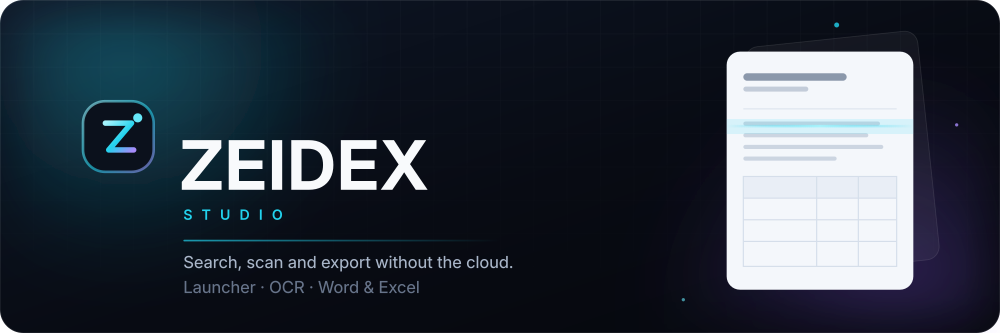
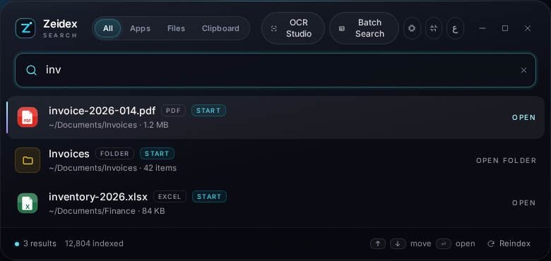
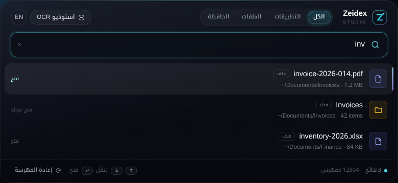
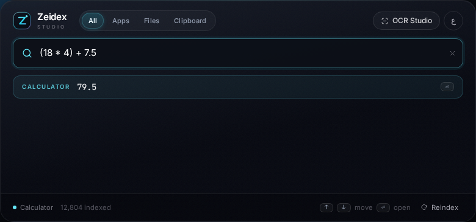
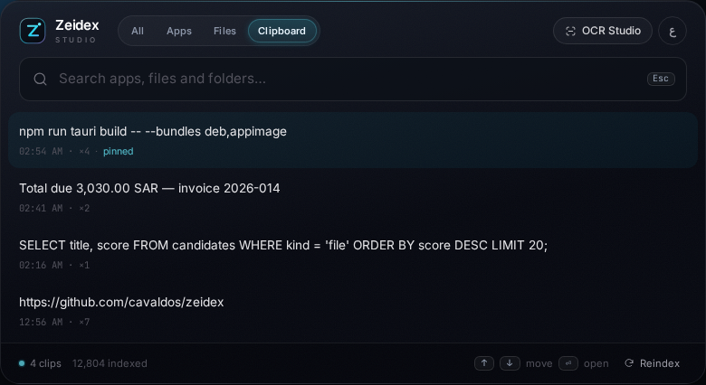
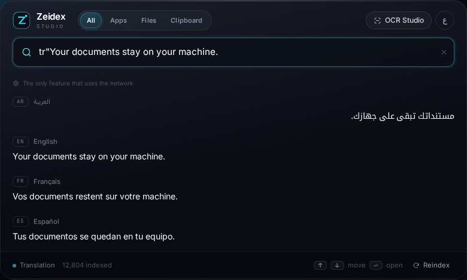
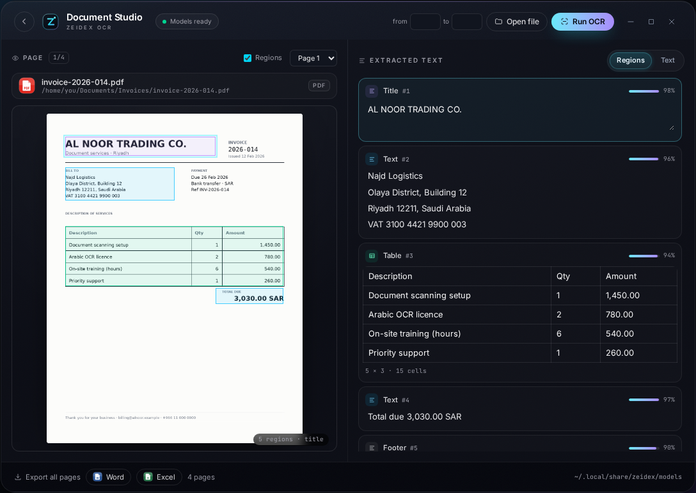
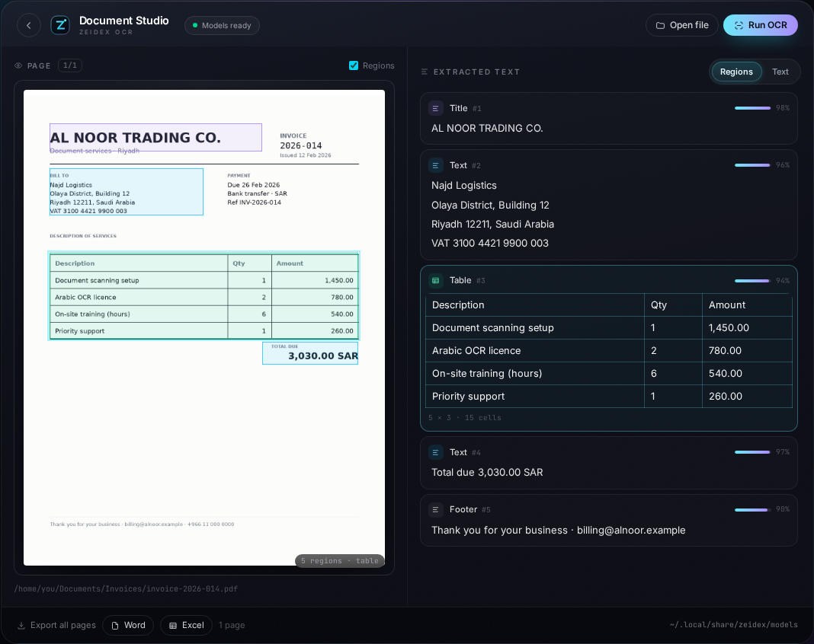
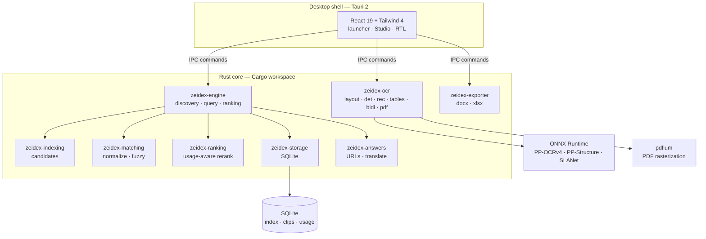
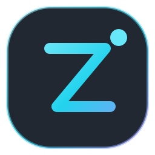

<p align="center">
  <picture>
    <source srcset="assets/brand/zeidex-hero-static.png" media="(prefers-reduced-motion: reduce)" />
    <source srcset="assets/brand/zeidex-hero-animated.gif" type="image/gif" />
    
  </picture>
</p>

<h1 align="center">Zeidex Studio</h1>

<p align="center">
  <strong>Find anything. Launch anything. Turn paper into editable documents — all without leaving your machine.</strong>
</p>

<p align="center">
  <a href="LICENSE"></a>
  
  
  
  
  
</p>

<p align="center">
  <a href="#quick-start">Quick start</a> ·
  <a href="#what-it-does">What it does</a> ·
  <a href="#document-studio">Document Studio</a> ·
  <a href="#architecture">Architecture</a> ·
  <a href="#contributing">Contributing</a>
</p>

---

## The short version

Zeidex Studio is a desktop launcher **and** an offline document AI in one binary.
Press <kbd>Alt</kbd>+<kbd>Space</kbd>, type three letters, hit <kbd>Enter</kbd>: an app opens,
a folder appears, a calculation is on your clipboard. Drop a scan or a PDF into the
Studio and you get **editable Word and Excel files** — layout, tables, merged cells and
Arabic right-to-left text included.

Nothing is uploaded. There is no account, no sync, no telemetry, and no network call
in the indexing or OCR path. The only feature that talks to the internet is translation,
because that is what translation is.

<table>
  <tr>
    <td width="50%" valign="top">
      <h3>Everything is local</h3>
      <p>Search runs against a SQLite index of your apps, files and folders. OCR runs on
      ONNX Runtime with models that ship separately and load from disk. Pull the network
      cable and the app still works.</p>
    </td>
    <td width="50%" valign="top">
      <h3>Native, not a browser tab</h3>
      <p>A Tauri shell around a Rust core: one native binary instead of a bundled
      Chromium, native menus and tray, and a global hotkey that works while the window
      is hidden.</p>
    </td>
  </tr>
  <tr>
    <td width="50%" valign="top">
      <h3>Arabic is a first-class citizen</h3>
      <p>Recognition, BiDi reordering, right-to-left layout, and RTL-aware Word/Excel
      exports. The interface flips with one click, using logical CSS properties so
      nothing drifts out of place.</p>
    </td>
    <td width="50%" valign="top">
      <h3>Documents, not text dumps</h3>
      <p>Titles, lists, figures, tables with row/col spans — all preserved into a
      <code>.docx</code> that opens as a real table, and a <code>.xlsx</code> with numeric
      cells and merged ranges.</p>
    </td>
  </tr>
</table>

## What it does

### Launcher

One input, four modes. <kbd>Tab</kbd> cycles the filter, <kbd>↑</kbd>/<kbd>↓</kbd> move,
<kbd>Enter</kbd> runs, <kbd>Esc</kbd> hides the window.

<table>
  <tr>
    <td width="50%"></td>
    <td width="50%"></td>
  </tr>
  <tr>
    <td align="center"><sub>Fuzzy search across apps, files and folders, ranked by match quality <em>and</em> how you actually use them.</sub></td>
    <td align="center"><sub>Full RTL: tabs, results, counts, and the documents you export.</sub></td>
  </tr>
</table>

| | |
| --- | --- |
| **Search** | Fuzzy matching with accent/case folding, alias groups (`alias_code=Visual Studio Code\|Cursor\|Zed`), and a usage-aware re-rank so the thing you open every morning wins ties. |
| **Calculator** | Type an expression and it is evaluated as you type. <kbd>Enter</kbd> copies the raw, re-parseable number — not the prettified `1,000,000`. |
| **Clipboard history** | Every text clip is stored locally in SQLite, de-duplicated, searchable, pinnable, and never expires unless you say so. |
| **Translation** | `tr"` followed by text translates into Arabic, English, French and Spanish. Each target fails independently, so one rate-limited request cannot break the panel. |
| **Web search / URLs** | Type a URL to open it, or a phrase to search the web in your default browser. |
| **Preferences** | Preferred editor and terminal are resolved per platform, so “open in editor” means the right editor. |

Keyboard reference:

| Key | Action |
| --- | --- |
| <kbd>Alt</kbd>+<kbd>Space</kbd> | Show or hide the launcher (global, works while hidden) |
| <kbd>↑</kbd> <kbd>↓</kbd> | Move the selection |
| <kbd>Enter</kbd> | Run the selected result, or copy the calculator result |
| <kbd>Esc</kbd> | Hide the window |
| <kbd>Tab</kbd> | Cycle All → Apps → Files → Clipboard |

<table>
  <tr>
    <td width="33.3%"></td>
    <td width="33.3%"></td>
    <td width="33.3%"></td>
  </tr>
  <tr>
    <td align="center"><sub>Calculator: <kbd>Enter</kbd> copies the raw value.</sub></td>
    <td align="center"><sub>Clipboard: pinned clips survive the retention sweep.</sub></td>
    <td align="center"><sub>Translation: four targets, each failing on its own.</sub></td>
  </tr>
</table>

### Document Studio

Images and PDFs go in; a structured page comes out. Every box is editable, every table
is a real table, and the export is a document you can keep working in.

<table>
  <tr>
    <td width="50%"></td>
    <td width="50%"></td>
  </tr>
  <tr>
    <td align="center"><sub>Layout regions on the left, editable text on the right. Click a box to jump to its editor.</sub></td>
    <td align="center"><sub>SLANet recovers the grid, including row and column spans, before export.</sub></td>
  </tr>
</table>

The pipeline, all on-device:

```text
image / PDF page
   │
   ├─▶ layout        PicoDet (PP-StructureV2, 5 classes)  ──▶ title · text · list · table · figure
   │
   ├─▶ text lines    DBNet (PP-OCRv4 det)  ──▶ boxes scaled back and unclipped
   │        └─▶ recognition  PP-OCRv4 (English / Arabic dictionaries)
   │                 └─▶ Arabic BiDi reordering  ──▶ logical-order text
   │
   └─▶ tables        SLANet sequence decoder  ──▶ grid, spans, per-cell text
                              │
                              ▼
                     editable page model
                              │
                   ┌──────────┴──────────┐
                   ▼                     ▼
              .docx (RTL bidi,      .xlsx (RTL sheet,
              native tables,        numeric cells,
              merged cells)         merged ranges)
```

Why the details matter:

- **Detection boxes are unclipped.** DBNet's probability mask covers only the middle band
  of a line. Cropping it raw cuts Arabic ascenders and diacritics, so boxes are expanded
  with PaddleOCR's `unclip` ratio after the scale factor is applied.
- **Tables are decoded, not guessed.** SLANet emits structural tokens (`<thead>`, `<tr>`,
  `<tbody>`, `colspan`, `rowspan`); the editor builds the grid from those tokens, so what
  you see is what the exporter writes.
- **Arabic is stored in logical order.** The UI shapes it for display; the exporters write
  logical order with `bidi` set on the paragraph and sheet, which is what Word and Excel
  expect.
- **PDFs are rasterized locally** with pdfium — no ghostscript, no cloud converter.

### Privacy

| | |
| --- | --- |
| Network calls in search, indexing, OCR and export | **none** |
| Network calls in translation | Google `gtx` endpoint, only when you use `tr"` |
| Telemetry, crash reporting, analytics | **none** |
| Files read | only the ones you index or open |
| Model downloads | one-time, by `scripts/fetch_models.sh`, checksum-verified |

The database — search index, clipboard history, usage history — lives in your platform's
data directory: `~/.local/share/zeidex` on Linux, `~/Library/Application Support/zeidex` on
macOS, `%APPDATA%\zeidex` on Windows. Delete that folder and the app forgets everything.
The config file is `~/.zeidex/config` on every platform.

## Quick start

### Build from source

Requirements: Rust (pinned by `rust-toolchain.toml`), Node 20+, and the usual
[Tauri prerequisites](https://v2.tauri.app/start/prerequisites/) for your platform.

```bash
git clone https://github.com/zeiad6/zeidex.git
cd zeidex

# 1. OCR models, once (≈ 35 MB, checksum-verified)
make models

# 2. Runtime libraries: ONNX Runtime + pdfium
#    Put libonnxruntime.{so,dylib,dll} and libpdfium.{so,dylib,dll}
#    in src-tauri/resources/lib/ so the bundle ships them, or install them
#    system-wide and set ORT_DYLIB_PATH / ZEIDEX_PDFIUM_LIBRARY.

# 3. Run it
make frontend-install
make tauri-dev            # development
make tauri-build          # release bundles for the current OS
```

`make tauri-build` produces `.deb` + `.appimage` on Linux, `.msi` + `.nsis` on
Windows, and `.dmg` on macOS. Nothing is committed: pushing a `v*` tag runs
`.github/workflows/release.yml`, which builds on native runners and attaches the
bundles to a draft release. MSI is built on Windows because WiX cannot run on
Linux. ONNX Runtime and pdfium are staged into the bundle by that workflow; a
local build uses whatever is in `src-tauri/resources/lib/` (see
[build and release](assets/docs/build-and-release.md)).

### Verify the build

```bash
make core-test     # the whole Rust workspace
make core-fmt      # formatting
make core-clippy   # clippy, unwrap/expect denied in production paths
make frontend-build
make ocr-test      # real models, real page — needs ORT_DYLIB_PATH
```

## Usage

| What | How |
| --- | --- |
| Search | <kbd>Alt</kbd>+<kbd>Space</kbd>, type, <kbd>Enter</kbd> |
| Calculate | Type the expression; the result row appears above the results |
| Translate | `tr"` + text |
| Clipboard history | <kbd>Tab</kbd> to the Clipboard filter |
| Web search | Type a phrase and pick the web result; type a URL to open it |
| Documents | **OCR Studio** in the header → **Open file** → **Run OCR** |

Configuration lives in `~/.zeidex/config`:

```ini
# Preferred tools, used by "open in…" actions
editor=nvim
terminal=alacritty

# Treat these as one app when searching
alias_code=Visual Studio Code|Cursor|Zed
```

## Architecture



The Rust workspace builds and tests **without** Tauri, Node or a webview, which is
why the OCR and export logic can be tested in CI on two operating systems.

| Crate | Responsibility |
| --- | --- |
| `zeidex-engine` | Discovery, query parsing, search, platform detection |
| `zeidex-indexing` | The `Candidate` type and its id scheme |
| `zeidex-matching` | Query normalization and fuzzy scoring |
| `zeidex-ranking` | Base score adjusted by exact/prefix match and usage history |
| `zeidex-storage` | SQLite: candidates, usage events, clips, URL history, settings |
| `zeidex-tools` | Preferred editor/terminal resolution per platform |
| `zeidex-answers` | URL classification; translation behind a feature flag |
| `zeidex-ocr` | The offline document AI pipeline |
| `zeidex-exporter` | `.docx` and `.xlsx` writers |

## Limits, stated plainly

- **The Arabic recognizer is the weak link.** `arabic_PP-OCRv4_rec` handles shaped,
  logical-order Arabic but drops characters on very dense lines and does not read
  Arabic-Indic digits. Scans of clean printed Arabic work; handwriting, calligraphy and
  low-resolution phone photos do not. Upgrading the recognizer is the top item below.
- **Tables need visible rules.** SLANet infers the grid from structure tokens; borderless
  tables can lose a row or column. The cells are editable, so a wrong split is fixable,
  not fatal.
- **OCR is CPU-bound.** A 300 dpi A4 page takes several seconds on a laptop and minutes
  for a 40-page PDF. Detection caps the long side at 1600 px by default
  (`OcrEngineConfig::det_max_side`) so memory stays bounded on long documents.
- **Runtime libraries are not committed.** ONNX Runtime and pdfium are loaded
  dynamically; release bundles stage them, while a source build needs them in
  `src-tauri/resources/lib/` or on the system loader path.
- **Models are downloaded, never committed.** `scripts/fetch_models.sh` pulls nine files
  from Hugging Face mirrors and verifies them against `third_party/models/SHA256SUMS`.

## Roadmap

- [x] Cross-platform Tauri shell replacing the macOS-only SwiftUI app
- [x] Offline OCR: layout, text lines, tables, Arabic BiDi
- [x] Editable regions and tables in the Studio
- [x] `.docx` / `.xlsx` export with RTL support
- [x] Full RTL interface
- [ ] Better Arabic recognizer (dense lines, Arabic-Indic digits) — evaluate
      [`arabic_PP-OCRv5_mobile_rec_onnx`](https://huggingface.co/PaddlePaddle/arabic_PP-OCRv5_mobile_rec_onnx)
      (8 MB, same 48 px CTC decoder)
- [ ] Handwriting and low-quality photo handling
- [ ] Page-range selection when exporting a PDF
- [ ] Signed installers for macOS, Windows and Linux
- [ ] Plugin API for custom result providers

## Documentation

- [Architecture](assets/docs/architecture.md) — how the shell, the core and the frontend fit together
- [Rust core](assets/docs/core.md) — crates, search pipeline, OCR internals
- [OCR Studio](assets/docs/ocr-studio.md) — the document workbench, pane by pane
- [Build and release](assets/docs/build-and-release.md) — requirements, targets, checks, bundling

## Contributing

Bug reports and pull requests are welcome. Read [CONTRIBUTING.md](CONTRIBUTING.md) first —
it covers the commit style, the test gates, and the clippy rules (production paths deny
`unwrap()` and `expect()`). For a quick start:

```bash
make core-test && make core-fmt && make core-clippy && make frontend-build
```

## Developer

<table>
  <tr>
    <td width="96" align="center">
      
    </td>
    <td>
      <b>Zeidexsoft</b> — fast, local-first apps that respect your privacy.<br>
      Maintainer: <a href="https://github.com/zeiad6">@zeiad6</a> · Website: <a href="https://zeidexsoft.com">zeidexsoft.com</a> · Developer card: <a href="https://zeidexlink.zeidexsoft.com/zeidex">zeidexlink.zeidexsoft.com/zeidex</a>
    </td>
  </tr>
</table>

Support and suggestions: open an [issue](https://github.com/zeiad6/zeidex/issues) or reach the developer via the [developer card](https://zeidexlink.zeidexsoft.com/zeidex).

## Licence and attribution

Zeidex Studio is free software under the **GNU General Public License v3.0 or later**.
You may use it privately, at work, and commercially; if you distribute it or a modified
version, the source must stay available under the same licence and the copyright notices
must be preserved. If you need to embed it in a closed-source product, contact the
copyright holder to discuss a separate commercial licence.

Copyright © 2026 Zeidexsoft.

This project is a derivative of [`kunkka19xx/look`](https://github.com/kunkka19xx/look)
(GPL-3.0). The original macOS shell is preserved under `legacy/` for reference. Model and
library attributions are listed in [NOTICE](NOTICE).

<p align="center">
  <a href="https://star-history.com/#zeiad6/zeidex&Date">
    
  </a>
</p>

<p align="center">
  <sub>Built with Rust, Tauri, React and ONNX Runtime. No cloud, no account, no telemetry.</sub>
</p>
