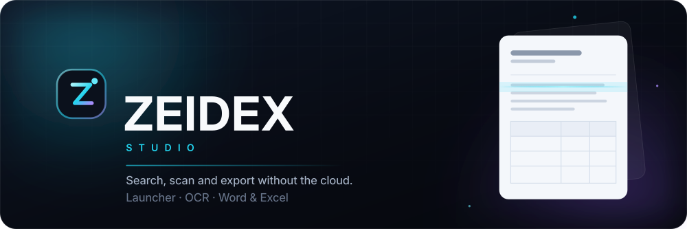
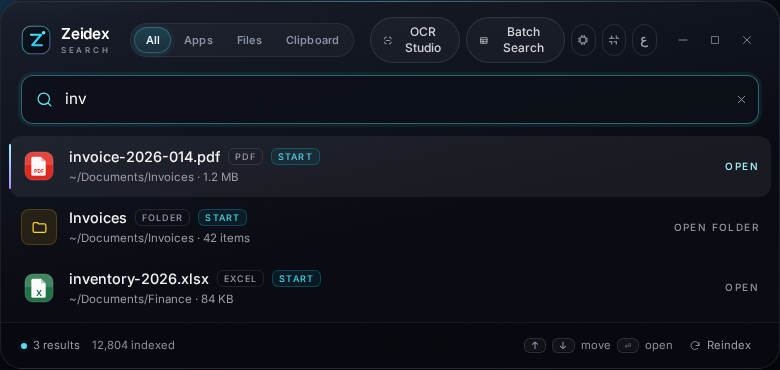
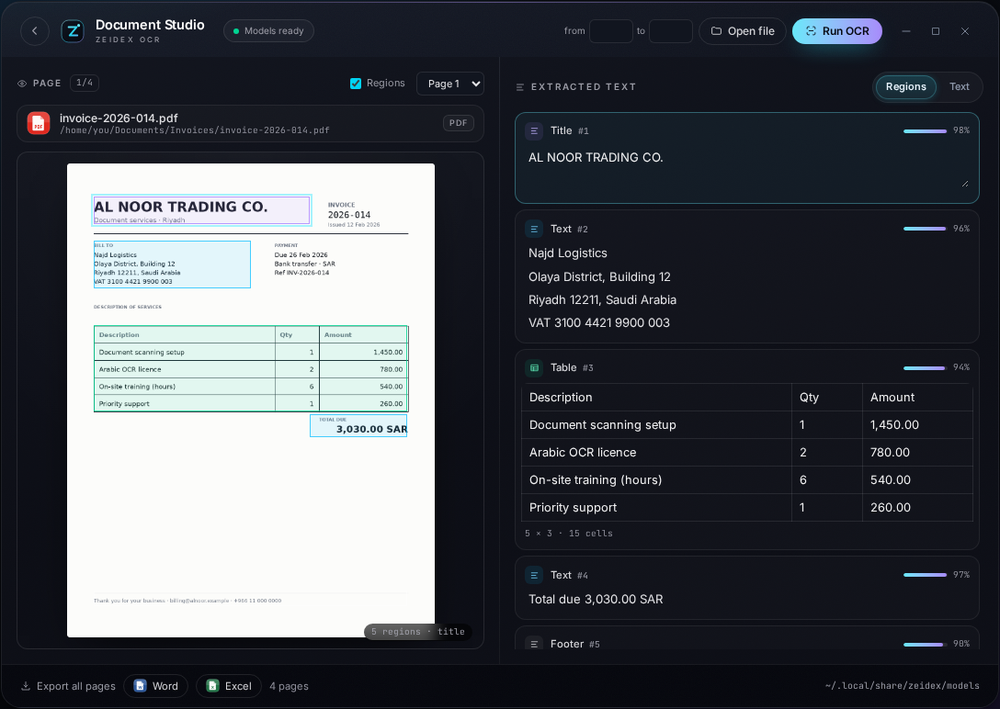

<p align="center">
  
</p>

<h1 align="center">Zeidex Studio 0.1.0</h1>

<p align="center">
  <b>Your files. Your machine. Your data.</b><br>
  A keyboard-first launcher and an offline document AI for Windows and Linux —<br>
  with macOS built from source.
</p>

<p align="center">
  
  
  
  
</p>

---

## The first public release

Zeidex Studio started as a personal launcher and grew into a document studio. This
release is the first one that packages both halves as a single, self-contained
desktop app: **no account, no telemetry, and no network calls at runtime** — the
OCR models, dictionaries, ONNX Runtime and the PDF rasteriser all ship inside the
installer.

### Highlights

| | |
| --- | --- |
| **Launch anything** | Fuzzy search across installed applications, files and folders, with keyboard-first navigation and a compact, always-ready window. |
| **Clipboard history** | Searchable clipboard buffer with pinning, so the snippet you copied an hour ago is still one keystroke away. |
| **Inline answers** | Calculator, unit and currency-style expressions, and translation right in the search field — no browser tab required. |
| **Document Studio** | Drop a scan or a PDF, detect the layout, read the text with PP-OCRv4, edit the result, then export to Word or Excel. |
| **Real Office files** | `.docx` with RTL `bidi` runs and native tables (including merged cells); `.xlsx` with a right-to-left sheet, numeric cells and merged ranges. |
| **Private by construction** | ONNX inference runs on your CPU, locally. Nothing is uploaded, and there is no analytics endpoint to disable. |

### What is inside the installer

- The Tauri desktop shell and the React interface (RTL and Arabic UI included).
- PP-OCRv4 detection and English/Arabic recognition models, plus their dictionaries.
- ONNX Runtime and PDFium, staged next to the binary and loaded locally.
- Roughly **34 MB of models** and **32 MB of runtime libraries**, so the first run
  works on a machine that has never seen the internet.

<p align="center">
  
  
</p>

---

## Downloads

| Platform | Package | Size | Best for |
| --- | --- | --- | --- |
| **Windows 10/11 (x64)** | `Zeidex.Studio_0.1.0_x64_en-US.msi` | 47 MB | Standard installer, per-machine or per-user, WiX-based. |
| **Windows 10/11 (x64)** | `Zeidex.Studio_0.1.0_x64-setup.exe` | 43 MB | Lightweight NSIS installer; pick this if MSI is blocked by policy. |
| **Linux (x86_64)** | `Zeidex.Studio_0.1.0_amd64.deb` | 52 MB | Debian, Ubuntu, Mint, Pop!_OS and derivatives. |
| **Linux (x86_64)** | `Zeidex.Studio_0.1.0_amd64.AppImage` | 125 MB | Any distribution; no installation, no root. |

> Builds are produced on GitHub's native runners from the tagged source, so every
> artifact matches the commit behind this release. macOS bundles are not part of
> this workflow yet — see [Build from source](#build-from-source).

### Install

**Windows — MSI**

```powershell
msiexec /i "Zeidex.Studio_0.1.0_x64_en-US.msi"
```

**Windows — NSIS**

```powershell
"Zeidex.Studio_0.1.0_x64-setup.exe"
```

**Debian / Ubuntu**

```bash
sudo apt install ./Zeidex.Studio_0.1.0_amd64.deb
```

**AppImage**

```bash
chmod +x "Zeidex.Studio_0.1.0_amd64.AppImage"
./"Zeidex.Studio_0.1.0_amd64.AppImage"
```

The Linux packages depend on `libwebkit2gtk-4.1-0`, `libgtk-3-0` and
`libayatana-appindicator3-1`; `apt` installs them automatically. On distributions
that do not ship WebKitGTK 4.1, use the AppImage.

---

## First run

1. Start Zeidex Studio — the launcher is ready immediately, with no indexing
   wizard and no sign-in.
2. Type to search applications, files and folders; press `Enter` to open, or use
   the arrow keys to move through results.
3. Open **Studio** to drop a scan or PDF, run detection and recognition, edit the
   recognised text, and export to `.docx` or `.xlsx`.
4. Set `ZEIDEX_MODELS_DIR` only if you want the models stored somewhere other than
   the bundled location.

Configuration lives in `~/.zeidex` (Linux/macOS) or `%APPDATA%\zeidex` (Windows).

---

## Verification

Every asset is built from the tag `v0.1.0`. SHA-256 checksums are attached to this
release as `SHA256SUMS`; verify a download before installing:

```bash
sha256sum -c SHA256SUMS --ignore-missing
```

```powershell
Get-FileHash "Zeidex Studio_0.1.0_x64_en-US.msi" -Algorithm SHA256
```

---

## Known limitations

- **Arabic recognition** is usable but not perfect: dense lines can lose
  characters and Arabic-Indic digits are not read reliably yet. The next
  recogniser candidate is
  [PP-OCRv5 Arabic](https://huggingface.co/PaddlePaddle/arabic_PP-OCRv5_mobile_rec_onnx).
- **No auto-update** in this release; download a newer installer when one is
  published.
- **macOS** builds are not produced by this workflow. The shell compiles on macOS
  from source, but no signed `.dmg` ships here.

---

## Build from source

```bash
git clone https://github.com/zeiad6/zeidex.git
cd zeidex
make models            # one-time download of the ONNX models
make core-test         # Rust core test suite
make frontend-install  # npm install
make tauri-build       # platform bundle
```

Requirements: Rust 1.99.1 (pinned in `rust-toolchain.toml`), Node.js 22, and the
Tauri system dependencies for your platform. See
[`assets/docs/build-and-release.md`](https://github.com/zeiad6/zeidex/blob/main/assets/docs/build-and-release.md).

---

## Links

- [README](https://github.com/zeiad6/zeidex#readme) — screenshots, architecture and configuration
- [Contributing](https://github.com/zeiad6/zeidex/blob/main/CONTRIBUTING.md)
- [Issues](https://github.com/zeiad6/zeidex/issues)
- [Developer card](https://zeidexlink.zeidexsoft.com/zeidex) · [zeidexsoft.com](https://zeidexsoft.com)

<p align="center"><sub>Copyright © 2026 Zeidexsoft · GPL-3.0-or-later · Commercial use permitted</sub></p>
